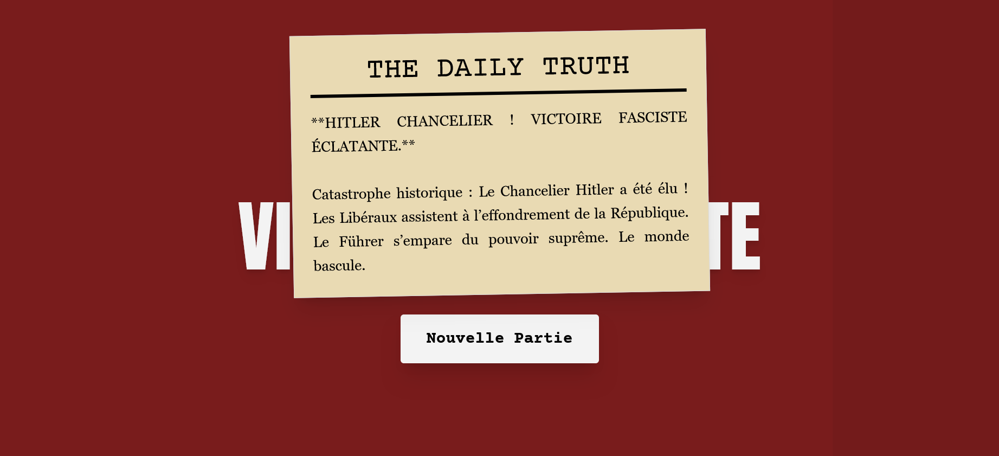

# Secret Hitler – Édition Interactive

Adaptation web du jeu de société Secret Hitler, jouable dans le navigateur, seul contre des bots ou à plusieurs sur le même appareil.

Projet informatique, L2 MIASHS, Université Paris Nanterre, 2025.
Réalisé en binôme avec Taha Turkan.

## Aperçu

## Fonctionnalités

- Mode solo contre des bots (rôle aléatoire) et mode spectateur pour regarder les bots jouer
- Mode multijoueur sur un seul appareil, avec écran de passage entre les joueurs
- Toutes les phases du jeu : élection, séance législative, pouvoirs présidentiels (investigation, regard, élection spéciale, exécution)
- Graphe de confiance entre les joueurs
- Règlement détaillé intégré et musique de fond
- IA générative avec l'API Gemini (optionnel) : flashs info radio après chaque loi, analyste qui désigne un suspect, article de journal en fin de partie

## Technologies

HTML, CSS, JavaScript, React 18 (chargé par CDN), API Gemini.

## Lancer le projet

Ouvrir `index.html` dans un navigateur récent (Chrome, Firefox, Edge). Aucune installation n'est nécessaire. Pensez à activer le son.

Le jeu fonctionne entièrement sans clé API : les flashs info utilisent alors des phrases prédéfinies et l'analyste IA est désactivé.

Pour activer les fonctions IA :
1. Créer une clé gratuite sur [Google AI Studio](https://aistudio.google.com/app/apikey).
2. La coller dans le champ prévu sur l'écran d'accueil du jeu.

La clé reste dans le navigateur le temps de la session, elle n'est jamais enregistrée dans le code.

## Rapport

Le rapport du projet est disponible en PDF : [L2_rapport_Turkan_Bouydarne.pdf](L2_rapport_Turkan_Bouydarne.pdf). Ses sources LaTeX et ses images sont dans le dossier `rapport/`.

## Licence du jeu original

Adaptation web non officielle du jeu Secret Hitler (Goat, Wolf & Cabbage), sous licence CC BY-NC-SA 4.0.
